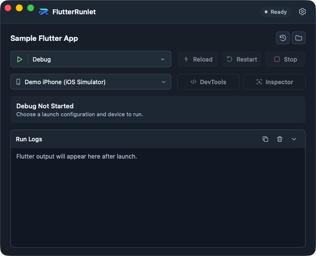
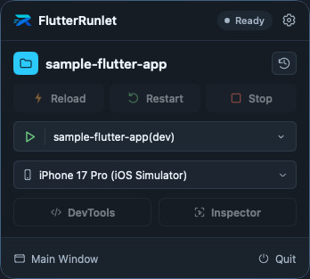
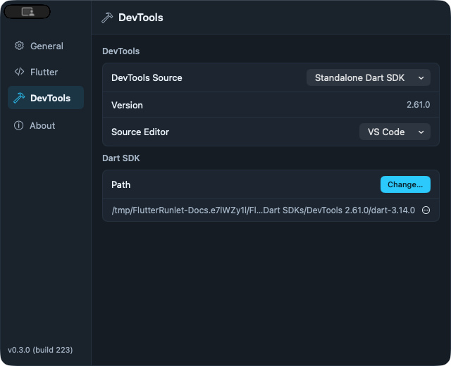
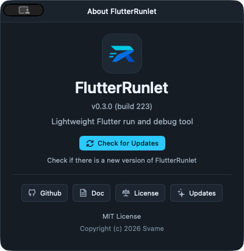

  

<h1 align="center">FlutterRunlet</h1>

<strong>Run and debug Flutter apps from the macOS menu bar.</strong>

  English · <a href="README.zh-CN.md">简体中文</a> · <a href="https://github.com/atypiape/flutter-runlet/releases">Downloads</a>

FlutterRunlet is a native macOS app that reads the VS Code launch configurations and tasks already in your Flutter project. Start a debug session, hot reload, or open DevTools from the menu bar or the main window.

## Why I built it

I do most of my coding with AI tools now and rarely need VS Code for editing. But to launch and debug a Flutter app, I still had to open it for the Flutter extension. On my machine that usually meant another editor window on the desktop and about 2–3 GB of memory for an app I was only using as a debugger.

I built FlutterRunlet so I could keep my existing Flutter configurations, leave VS Code closed, and reach the debug controls from the menu bar.

## Screenshots

| Main window | Menu bar |
| :---: | :---: |
|  |  |
| **DevTools settings** | **About** |
|  |  |

The DevTools, [full path popover](docs/screenshots/devtools-path.jpg), [General settings](docs/screenshots/settings.jpg), and About screenshots are from v0.3.0 build 223. The main window and menu bar were captured on v0.2.0 with sample data.

## Install

Download the universal macOS DMG from the [latest GitHub release](https://github.com/atypiape/flutter-runlet/releases/latest). Follow the release page's checksum instructions, open the DMG, and drag FlutterRunlet to **Applications**.

The deployment target is macOS 15.0. Universal builds include Apple Silicon and Intel. Runtime testing was done on Apple Silicon with macOS 26.7.1; running on Intel or macOS 15 has not yet been verified. See the [release notes](docs/RELEASE-NOTES.md) (Simplified Chinese).

## Start debugging

1. Install your project's Flutter SDK and get a simulator or physical device ready. In **Settings → Flutter**, check the SDK source and version. You can use the SDK on your PATH, pick one manually, or prefer the project's FVM configuration.
2. Open a Flutter project with `.vscode/launch.json`. If your launch configuration refers to tasks, include `.vscode/tasks.json` too. Select a **Debug** configuration and a device, then click **Run**.
3. Once connected, hot reload, hot restart, or open DevTools and the Inspector in your browser. The main window lets you view, copy, and clear the session log.
4. Click **Stop** and let any post-debug task finish. If environment recovery fails, reopen the affected project and use **Retry Recovery** to run the original task again.

Choose VS Code (default), Cursor, or Zed in **Settings → DevTools → Source Editor**. In DevTools 2.61.0 and later, select a widget and click its source location in the Inspector details pane. With bundled DevTools 2.60.0, selecting the widget opens its source. FlutterRunlet launches the editor on demand for Dart files in the active project.

In **Settings → DevTools → DevTools Source**, choose **Standalone Dart SDK** and select its directory. Dart 3.14.0 includes DevTools 2.61.0. To select another directory, click **Change…** beside **Path** in the **Dart SDK** group. The path appears on the next line. Hover over it to see the full path, or click **…** to open a popover with **Copy Path**.

FlutterRunlet starts the standalone DevTools on demand and connects the Inspector to the active session. The project continues to use its configured Flutter and Dart SDK. Select **Bundled with Flutter** to switch back.

Click **Open Inspector** again to return to its existing tab for the current session. After closing the tab, click again to reopen it. Edge, Chrome, and Safari require macOS browser automation permission for this feature.

Both views control the same session. Changing the device while debugging sets up the next run; the current session stays on its original device. The app supports English and Simplified Chinese. In **Settings → General → App Appearance**, Dark is the default. You can choose Light or Follow System. The change applies immediately and persists across launches.

FlutterRunlet supports **Debug** configurations. Profile and Release configurations, long-running background tasks, complex interactive tasks, and some VS Code extension variables are outside its scope. It leaves your configuration files alone and runs the pre-launch and post-debug tasks you configured. Try the [sample VS Code configurations](docs/examples/sample-flutter-app/README.md) or see the [compatibility details](docs/02-TECHNICAL.md#2-launchjson-基本契约v01) (Simplified Chinese).

Use **Settings → About** or **About FlutterRunlet** to check for updates. In-app updates are available only for verified stable releases. Install pre-release builds manually.

## Development

See the [developer guide](docs/DEVELOPMENT.md) (Simplified Chinese) for building from source, running tests, and packaging.

## License

[MIT](LICENSE).
