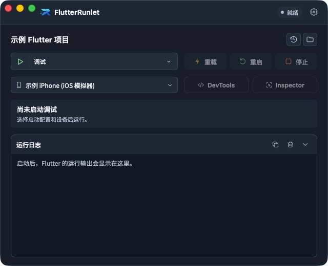
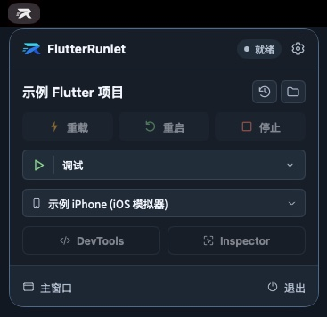
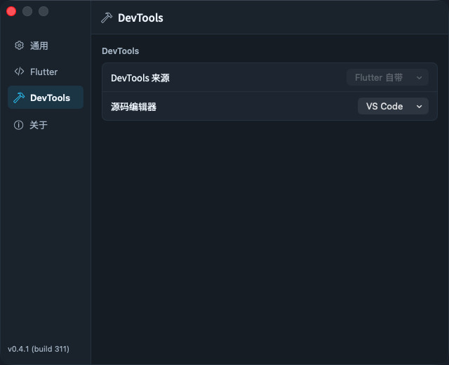
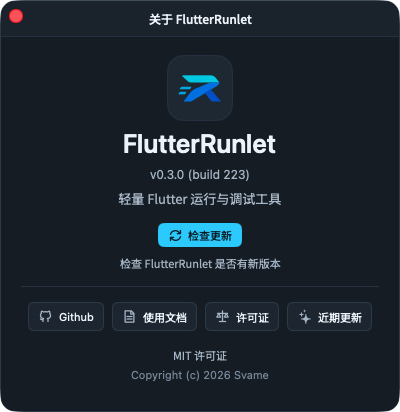

  

<h1 align="center">FlutterRunlet</h1>

<strong>从 macOS 菜单栏启动和调试 Flutter 应用。</strong>

  <a href="README.md">English</a> · 简体中文 · <a href="https://github.com/atypiape/flutter-runlet/releases">下载</a>

FlutterRunlet 是一款原生 macOS 应用，直接读取 Flutter 项目已有的 VS Code 启动配置和任务。从菜单栏或主窗口，就能启动调试、热重载，或打开 DevTools。

## 为什么做 FlutterRunlet

平时用 AI 工具写代码，已经很少需要打开 VS Code 编辑。但每次要启动和调试 Flutter 应用，我还是得打开 VS Code，用它的 Flutter 扩展。在我自己的工作流里，仅为了调试，VS Code 就会占用大约 2–3 GB 内存，编辑器窗口还挤占了桌面空间。

我做 FlutterRunlet，就是想保留项目原有的调试配置，关掉 VS Code，也能在菜单栏随手启动和控制调试会话。

## 界面截图

| 主窗口 | 菜单栏 |
| :---: | :---: |
|  |  |
| **DevTools 设置** | **关于** |
|  |  |

DevTools、[通用设置](docs/screenshots/zh-CN/settings.jpg)和「关于」截图展示 v0.3.0 build 223 界面，使用示例数据。主窗口和菜单栏截图拍摄于 v0.2.0，也使用示例数据。

## 安装

在 [GitHub 发布列表](https://github.com/atypiape/flutter-runlet/releases)下载通用 macOS DMG。按发布页说明核对校验值，打开 DMG，将 FlutterRunlet 拖入「应用程序」。

最低部署目标为 macOS 15.0。安装包包含 Apple Silicon 和 Intel 架构。已在 Apple Silicon（macOS 26.7.1）上验证运行，Intel 和 macOS 15 实机运行尚未验证。详见[版本说明](docs/RELEASE-NOTES.md)。

## 开始调试

1. 安装项目所需的 Flutter SDK，准备好模拟器或真机。在「设置 → Flutter」确认 SDK 来源和版本，可以使用系统 PATH 中的 SDK、手动指定，或优先使用项目的 FVM 配置。
2. 打开含 `.vscode/launch.json` 的 Flutter 项目。若启动配置引用了任务，也要准备好 `.vscode/tasks.json`。选一个 **Debug** 配置和设备，点击「运行」。
3. 调试连接建立后，可以热重载、热重启，或在浏览器中打开当前会话的 DevTools 和 Inspector。再次点击运行并确认，可重启当前会话。主窗口可以查看、复制和清空日志。
4. 点击「停止」，等待后置任务结束。如果环境恢复失败，打开受影响的项目，点击「重试恢复」再次执行原任务。

在「设置 → DevTools → 源码编辑器」选择 VS Code（默认）、Cursor 或 Zed。在 DevTools 2.61.0 或更新版本中，选中 Widget 后点击详情面板的源码位置。SDK 自带的 DevTools 2.60.0 中，选中 Widget 时会跳到源码。编辑器按需启动，跳转范围为当前项目的 Dart 文件。

在「设置 → DevTools → DevTools 来源」选择「独立 Dart SDK」并指定目录，例如自带 DevTools 2.61.0 的 Dart 3.14.0。之后可在「Dart SDK」分组点击「路径」右侧的「更换…」。地址单独显示在下一行，太长时用省略号显示。悬停可查看完整路径，也可以点击行尾的「…」，在浮窗中查看和复制路径。

点击「打开 Inspector」时，FlutterRunlet 会启动独立 DevTools 并连接当前会话。项目仍使用原来的 Flutter 和 Dart。选择「Flutter 自带」可切回。

同一会话再次点击「打开 Inspector」时，FlutterRunlet 会切回已打开的 Inspector 标签页。关闭标签页后，再点击会重新打开。Edge、Chrome 和 Safari 需要允许 FlutterRunlet 使用 macOS 浏览器自动化。

主窗口和菜单栏控制同一个会话。调试中改选设备只影响下一次运行，当前会话仍留在原设备。界面支持简体中文和 English。「设置 → 通用 → 应用外观」默认深色，可改为浅色或跟随系统。选择立即生效并在重启后保留。

FlutterRunlet 支持 **Debug** 配置。Profile、Release、后台常驻任务、复杂交互任务及部分 VS Code 扩展变量不在支持范围内。FlutterRunlet 不改写配置文件，按原配置执行前置和后置任务。可试用 [VS Code 配置示例](docs/examples/sample-flutter-app/README.md)，或查阅[配置兼容说明](docs/02-TECHNICAL.md#2-launchjson-基本契约v01)。

在「设置 → 关于」或独立的「关于 FlutterRunlet」窗口可检查更新。应用内更新仅面向通过校验的正式版本，预发布包需手动安装。

## 开发

从源码运行、测试和打包的方法见[开发者指南](docs/DEVELOPMENT.md)。

## 许可证

本仓库采用 [MIT 许可证](LICENSE)。
