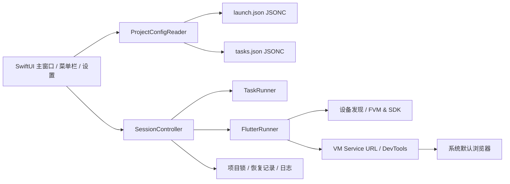
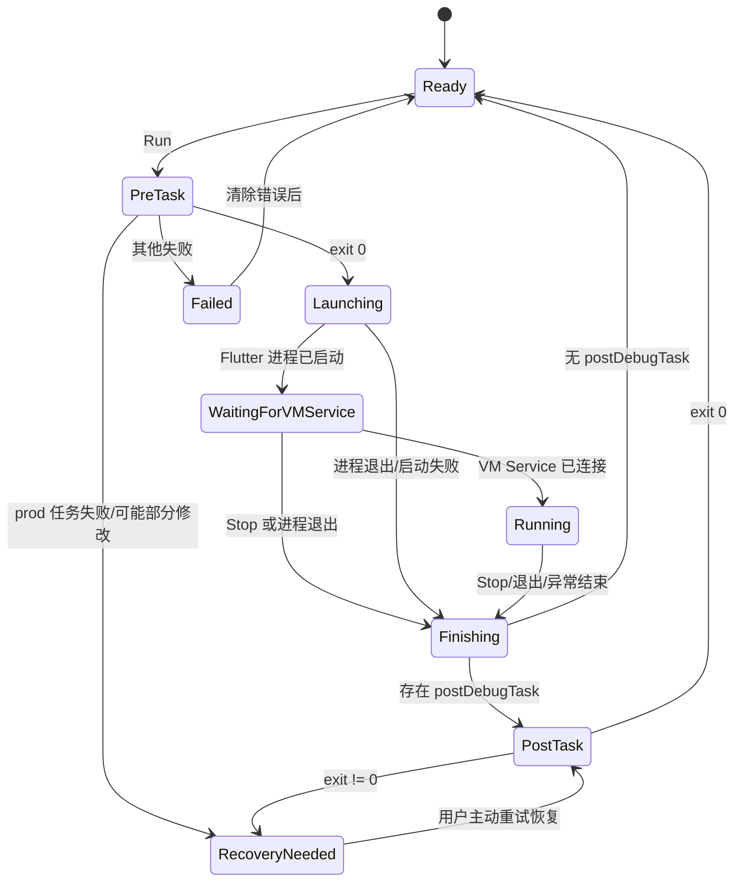

# 02 · 技术设计与 VS Code 配置兼容

本文记录 v0.1 的实施契约。应用已通过 G3 本地验收。最低部署目标为 macOS 15.0，macOS 15 运行兼容性未验证。[G3 验收记录](../.planning/milestones/v0.1-phases/05-stability-recovery-release/05-G3-ACCEPTANCE.md)

## 1. 架构原则



- 使用 Swift 6，SwiftUI 优先，AppKit 按需补充。主窗口与菜单栏复用同一个会话状态对象，使用原生窗口和控件。系统控件与画板有差异时遵循 macOS 原生行为，并在对应 Phase 的验收记录中注明差异与验证结果。
- 不使用 VS Code Extension Host，不引入 Dart/Flutter VS Code 插件运行时；底层调用 Flutter SDK、Dart SDK、shell 任务与系统浏览器。
- P1 审计了 Flutter GUI Runner 的实现和许可证。FlutterRunlet 参考其共享场景结构并独立实现，实际导入清单无上游源码、资源或依赖。今后若导入上游代码，须保留原 MIT 许可证和版权声明。[P1 上游审计](../.planning/milestones/v0.1-phases/01-upstream-audit-ui-shell/01-UPSTREAM-AUDIT.md)
- 禁止用户项目配置的隐式修改。选择项（最近项目/设备/界面语言）是应用偏好，不是第二套 dev/test/prod 配置。

## 2. `launch.json` 基本契约（v0.1）

用户 Flutter 项目的 `launch.json` 和 `tasks.json` 是启动参数、环境变量及前后置任务的权威来源。应用按契约解析和传递配置，保留原文件及用户配置的环境变量和值。遇到不支持的配置须明确报错，禁止静默跳过任务或推测执行结果。

| 字段 | 规则 |
|---|---|
| `configurations[].name` | 原样显示，不翻译；允许空格/括号；内部以项目路径 + 配置标识引用 |
| `type` / `request` | 支持 `dart` + `launch`（Flutter 工程）；不认识的组合提示不支持 |
| `program` / `cwd` | 默认入口 `lib/main.dart`、工作目录为项目根；显式值须正确解析 |
| `flutterMode` | v0.1 只支持 `debug`。非 Debug 配置保留名称并显示不可用原因。执行层在启动任务和 Flutter 之前再次验证 |
| `toolArgs` | 官方 Flutter 工具参数来源，准确构造进程参数 |
| `args` | 官方语义为应用参数；用户旧配置将 `--dart-define=...` 放在这里，见下方兼容规则 |
| `env`, `osx.env` | 合并继承环境和 macOS 覆盖值，支持 `${env:PATH}` 等插值 |
| `deviceId` | 显式指定时与设备选择规则一致，冲突需提示，不得静默改设备 |
| `preLaunchTask`, `postDebugTask` | 在 `tasks.json` 中按任务 `label` 查找并执行 |

文件解析需要支持 JSONC 注释与尾随逗号（VS Code 配置常见格式）；解析失败时给出文件名、位置和原因，不尝试“修复”原文件。

### 关于 `args` / `toolArgs` 的特殊兼容

Dart Code 官方文档区分 Flutter 工具参数 `toolArgs` 和传给 Dart `main()` 的应用参数 `args`。部分既有项目把 `--dart-define=...` 写在 `args` 中。本项目**必须兼容此既有行为，但不重写用户文件**：

1. 首选 `toolArgs`，按官方语义透传。
2. 仅对 `args` 中可被**明确识别为 Flutter 工具参数的 `--dart-define=KEY=VALUE`** 做兼容迁移，保持顺序/原值；必要时在日志显示“兼容旧配置”。
3. 其他 `args` 保持应用参数语义；不能正确映射或存在冲突时必须阻止运行并说明如何迁移到 `toolArgs`，不可盲目拼接。
4. 不注入 `--flavor` 或入口文件替代项；用户原配置未定义的字段不能自作主张补充。

虚构项目的 prod 配置示例：

```jsonc
{
  "name": "sample-flutter-app(prod)",
  "request": "launch",
  "type": "dart",
  "flutterMode": "debug",
  "osx": { "env": { "PATH": "/opt/homebrew/bin:/usr/local/bin:${env:PATH}" } },
  "preLaunchTask": "sample:select-prod",
  "postDebugTask": "sample:select-test",
  "args": [
    "--dart-define=APP_ENV=prod",
    "--dart-define=ENABLE_SAMPLE_FEATURE=false",
    "--dart-define=DEMO_BUILD_NUMBER=1001"
  ]
}
```

其他三套配置为 `sample-flutter-app(dev)`、`sample-flutter-app(physical)`、`sample-flutter-app(test)`；完整配置、任务与故障复现见[公开示例](examples/sample-flutter-app/README.md)。**以上是项目兼容测试样例，不应直接写成 FlutterRunlet 自身运行配置。**

## 3. `tasks.json` 执行契约（v0.1）

公开示例用标准 shell 任务模拟 Firebase 环境切换，命令为：

```text
/bin/sh "${workspaceFolder}/scripts/simulate-firebase-switch.sh" dev --quiet
/bin/sh "${workspaceFolder}/scripts/simulate-firebase-switch.sh" test --quiet
/bin/sh "${workspaceFolder}/scripts/simulate-firebase-switch.sh" prod --quiet
```

对应 `label` 分别是 `sample:select-dev` / `sample:select-test` / `sample:select-prod`。路径中的 `${workspaceFolder}` 解析为**当前打开的 Flutter 项目根目录**，不是 FlutterRunlet 仓库目录。

必须支持：

- `tasks[]` 按 `label` 查找；`type: shell`，必要的 `type: process`；`command`、`args`、`options.cwd` / `options.env` 的基本执行语义。
- macOS 的环境继承；`launch.json` 中的 `osx.env` 属于启动配置环境，不得擅自应用到所有 tasks；tasks 自身环境按 VS Code 语义处理。
- 命令参数安全引用：用 Process 参数向量或可审查的 shell 命令拼装，不要通过未转义的用户输入插值创建 shell 命令。
- 默认等待前置任务退出码 0，再启动 Flutter；失败阻断并呈现标准错误。
- 运行会话终结后执行后置任务；后置任务失败显示醒目的「环境恢复失败」及重试入口。
- `presentation`、`problemMatcher: []` 是 VS Code UI/问题分析配置，不影响本项目是否执行 shell 脚本。

**范围限制**：非标准扩展任务、后台常驻任务（`isBackground` / background problem matcher）、不支持的 `${command:...}` 变量、复杂交互任务必须明确显示「暂不支持」，不能悄悄跳过。若有 `dependsOn`，在明确实现并通过对应测试前同样显式拒绝；不把未经测试的任务类型说成已经支持。

## 4. 单项目调试生命周期与 prod 安全



- Firebase 配置是项目级共享可变状态。每个项目至多一个活跃的、受 FlutterRunlet 管理的会话与环境切换操作（项目路径规范化后加锁）。项目切换、启动新环境及退出应用都必须先解决前一会话的终止/后置恢复。
- `prod` 启动前记录「可能需要恢复 test」的**持久风险标记**；脚本成功/失败、进程崩溃或 App 退出时按规则清除或保留。恢复完成之前不可报“已安全结束”。
- 正常停止时，优雅结束受管会话，确认进程组退出后再运行 `postDebugTask`。异常终止也应尝试恢复。App 被 `kill -9` 或断电后，下次启动检测风险标记并提供明确恢复入口。
- 对于明确指定的 `postDebugTask`，不得私自换成其他任务；项目指定的 prod → test 恢复必须按原任务执行。
- 会话日志中敏感 VM Service URL 含 token；不应默认长期持久化未遮罩的完整 URL。日志内容和折叠状态分别管理。清空后折叠、展开时，旧日志保持清空，新收到的输出可正常显示。

## 5. Flutter SDK / FVM / 设备

SDK 解析建议：当「优先使用项目 FVM」启用且项目具有有效 FVM 配置时，使用该项目的 Flutter SDK；否则按「手动指定 SDK（如选择）」→ 系统 `PATH` 中 Flutter。**显示 SDK 与运行 SDK 必须一致**。

- 项目 `.fvmrc` 与 `.fvm/flutter_sdk` 的存在不等于 SDK 可用；执行 `flutter --version` 验证真实路径，必要时支持 `fvm flutter`。
- 有明确的项目 SDK 约束但该 SDK 缺失时，应提示并阻止启动，不能静默切换到另一版本。
- 设备通过 `flutter devices` 获取，名称原样展示。设备列表支持刷新，并在列表和选框中显示设备状态。选择可启动的离线 iOS 模拟器或 Android AVD 时，列表和选框显示启动进度。Flutter 发现目标设备后将其选中，调试任务仍需手动运行。Android AVD 清单与启动使用同一 Flutter SDK，通过 daemon 的 `emulatorId` 映射在线设备 ID。
- `sample-flutter-app(physical)` 是**普通命名配置**，由用户实际选择设备；不从字符串推断必须真机。

## 6. `flutter run` / DevTools

- 内嵌 worker 启动并管理 `flutter run --machine --debug` 进程。热重载和热重启通过当前 Flutter 进程的 machine 协议发送 `app.restart`，由 `fullRestart` 区分。停止时在取得当前 `appId` 后通过同一通道请求 `app.stop`。
- Run/Stop/Reload/Restart 的启用条件与同一会话状态一致，重复点击不得产生两个运行进程。
- 从已启动实例的输出中提取 VM Service / DevTools URL，浏览器打开的 URL 连接**当前会话**；新会话必须重新绑定。
- Inspector 直达链接需要在目标 Flutter/DevTools 版本实测；若不可靠，打开已连接的 DevTools 并提示用户进入 Inspector，不能伪造一个固定路由。
- 再次打开 Inspector 时，仅激活同一调试会话中匹配服务地址、页面路径和 VM Service 地址的标签。默认浏览器不支持自动化、未授权或找不到匹配标签时，交由系统打开。独立服务退出后，取消进行中的查找并清空旧标签记录。
- 源码跳转监听当前已验证会话的 `ToolEvent`。仅处理 Inspector 的导航事件，并把目标限制为当前项目内的普通 Dart 文件。临时订阅失败时在当前会话重试，断开会话时取消监听。
- 独立 DevTools 使用设置所选 Dart SDK 的 `bin/dart`。首次打开时由会话 worker 在本机回环地址和动态端口启动，验证启动事件后才把当前 VM Service 地址交给浏览器。启动中以最新的页面请求为准，同一调试会话复用服务，停止或退出调试时一并结束。独立 SDK 不参与项目 SDK 解析。
- 无 VM Service 时禁用调试页快捷入口或给出原因；不能打开一个看似成功但未连接的空白 DevTools 并报告成功。

## 7. 设置、语言和图标

- 「通用」管理语言、应用外观、登录时启动、启动后显示主窗口和记住最近项目。语言默认跟随系统。未保存外观偏好时使用深色，手动切换立即应用并持久化。启动偏好默认值见 [UI 规格](design/UI-SPEC.md#3-设置窗口通用)。
- 「Flutter」：SDK 来源、路径、当前 Flutter/Dart 版本、FVM 优先、`flutter doctor` 简要诊断；不负责安装/升级 SDK。
- 「DevTools」管理 DevTools 来源和源码编辑器。独立 Dart SDK 路径单独保存，变更立即更新此页显示的版本。路径放在「更换…」下一行，缩略时可悬停查看完整地址，也可用行尾按钮打开浮窗并复制路径。通过会话中的按钮手动打开 DevTools 或 Inspector。
- 「关于」显示应用身份、实际版本及构建号、许可证和上游版权。项目主页、README、许可证和近期更新链接由默认浏览器打开。
- app icon 与 status-bar icon 从同一 Figma 主 glyph 分别导出；后者采用 macOS template image，不直接使用带底色的方形位图。

## 8. 测试重点（Phase 设计依据）

| 分类 | 最小测试 |
|---|---|
| 解析 | 有注释/尾随逗号、变量替换、osx env、缺失文件、非法配置、未知类型 |
| 参数 | `toolArgs`、旧版 `args --dart-define`、冲突/混合参数、空 `program` |
| 任务 | shell 成功/失败、`${workspaceFolder}`、参数包含空格、任务不存在、不支持任务类型、`preLaunchTask` 失败阻断启动、`postDebugTask` 失败显著提示 |
| 环境安全 | prod 正常停止恢复、启动中失败、恢复失败重试、重复点击 Run、切换项目、进程/应用异常退出 |
| 会话 | VM URL 隔离、Hot Reload/Restart、Stop、进程退出、设备离线、日志增长与内存使用 |
| SDK | PATH、手动 SDK、有效/无效 FVM、展示版本与实际执行版本一致 |
| UI | 两种语言与跟随系统、菜单栏和主窗口一致、各状态按钮启禁用、DevTools 正确连接 |

## 9. 外部权威参考

- [Dart Code Launch Configuration（args/toolArgs、deviceId、flutterMode）](https://dartcode.org/docs/launch-configuration/)
- [Dart Code Tasks](https://dartcode.org/docs/tasks/)
- [Flutter DevTools CLI（VM Service 链接）](https://docs.flutter.dev/tools/devtools/cli)
- [Flutter GUI Runner（上游实现与许可证）](https://github.com/huseyiniriss/flutter-gui-runner)
